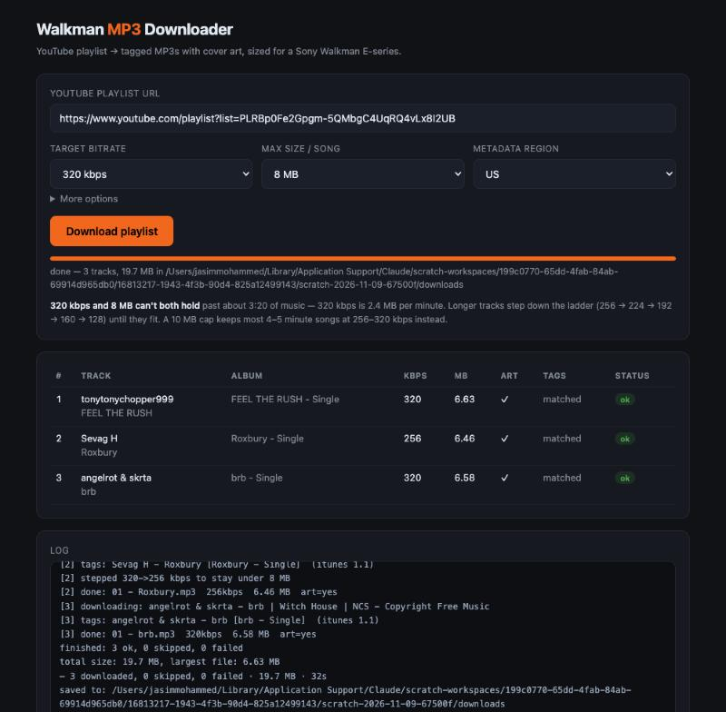

# Walkman MP3 Downloader

Paste a **YouTube Music album** or an ordinary **YouTube playlist**, get back
MP3s that a **Sony Walkman E-series** indexes correctly: real artist/album/track
tags, embedded cover art, and every file kept under a size cap you choose.



## Install

Needs Python 3.10+ and **ffmpeg** (`brew install ffmpeg` on macOS).

```bash
git clone https://github.com/<you>/walkman-dl.git
cd walkman-dl
./setup.sh
```

## Run it

```bash
./run.sh
```

Opens <http://127.0.0.1:7788>. Paste the playlist URL, press **Download playlist**.

Command line, same engine:

```bash
.venv/bin/python cli.py "https://music.youtube.com/playlist?list=OLAK5uy_XXXX" -o ~/Music/walkman
```

Any of these work as the link: a `music.youtube.com` album or playlist URL, a
`www.youtube.com` one, a single video, or a bare list id pasted on its own
(`OLAK5uy_...`, `PL...`).

## Album mode

A YouTube Music album link (`list=OLAK5uy_...`) is detected automatically. The
whole release is looked up **once** on iTunes, and every track then shares the
same album name, release year, cover art and **real track numbers**, in album
order:

```
2 item(s) found in "The Car"
album mode: looking up "The Car" by Arctic Monkeys
  matched: Arctic Monkeys - The Car (2022, 10 tracks, score 0.9)
[1] done: 01 - There'd Better Be A Mirrorball.mp3  256kbps  8.28 MB  art=yes
```

That beats looking each song up on its own, which tends to resolve singles and
compilations instead and leaves a folder of mismatched albums.

Mode is `auto` by default. `--album-mode always` forces it for any playlist
(useful when someone has uploaded an album as a normal playlist);
`--album-mode never` tags song by song. Same control sits under **More
options** in the UI.

If no iTunes release matches, it falls back to the YouTube album title with
playlist order as the track numbers.

Useful flags: `--album-mode always`, `--max-mb 8`, `--bitrate 320`, `--country IN`, `--flat`,
`--limit 5`, `--overwrite`, `--report out.csv`,
`--cookies-from-browser chrome` (for age-restricted or region-locked videos).

## About 320 kbps and the 8 MB cap

They collide. 320 kbps CBR is **2.4 MB per minute**, so 8 MB buys 3 minutes 20
seconds of music — nothing longer fits.

So each track gets the highest bitrate that still fits the cap:

| Song length | 7 MB cap | 8 MB cap | 10 MB cap |
|---|---|---|---|
| 3:00 | 256 | **320** | **320** |
| 3:30 | 256 | 256 | **320** |
| 4:00 | 224 | 256 | **320** |
| 4:30 | 192 | 224 | 256 |
| 5:00 | 160 | 192 | 256 |
| 6:00 | 128 | 160 | 224 |

The ladder only uses legal MPEG-1 Layer III rates (320/256/224/192/160/128/112/96).
Ask libmp3lame for 288k and it quietly gives you 256k instead.

**The default cap is 10 MB.** Almost every song up to 4 minutes then stays at
320 kbps, and a 16 GB Walkman still holds roughly 1,600 of them. Drop to 8 MB
and most songs land at 256 kbps - transparent on earbuds, but not the 320 you
asked for. The UI and `--max-mb` switch it per run.

## What each file gets

- **MP3, CBR, 44.1 kHz, stereo** — the format the E-series indexes most reliably.
- **ID3v2.3 tags** plus an ID3v1 tail. (v2.4 is only partly understood by these
  players, so it is not used.) Title, artist, album, album artist, track no.,
  disc no., year, genre.
- **Cover art**: 500×500 **baseline** JPEG in an APIC front-cover frame.
  Progressive JPEGs do not render on Walkman firmware, so art is always
  re-encoded baseline.
- **Text encoding**: Latin-1 where it fits, UTF-16 otherwise. UTF-8 ID3 frames
  show as garbage on these players, so they are never written.
- **FAT32-safe filenames**, `Artist/Album/01 - Title.mp3`, max 60 chars per part.

## Where tags come from

yt-dlp's own metadata is thin, so titles are cleaned ("Official Video", genre
tags, "NCS - Copyright Free Music", `#hashtags`) and matched against the free
**iTunes Search API**. Both title orders are tried — `Artist - Song` and
`Song - Movie/Album`, which is how a lot of Indian film music is titled — and
duration is used to break ties. Karaoke, tribute, acoustic, remix and
"Punjabi Version" style re-recordings are penalised so the original wins.

Set **Metadata region** to match the music: `IN` finds Bollywood and Punjabi
releases that the US storefront does not carry.

No confident match → it falls back to the cleaned YouTube title and crops the
video thumbnail to a square for the cover. The UI marks those rows `from YT`.

## Copying to the Walkman

Plug it in, then drag the artist folders into the player's `MUSIC` folder:

```bash
cp -R downloads/* /Volumes/WALKMAN/MUSIC/
```

Eject properly — the player rebuilds its database on disconnect, which is when
tags and cover art get picked up.

## Notes

- Private, deleted and region-blocked entries are skipped; the run continues.
- A 403 on a stream is retried against four other YouTube player clients before
  the track is given up on. If a whole playlist 403s, use
  `--cookies-from-browser chrome`.
- Existing files are skipped unless you pass `--overwrite`, so re-running a
  playlist only fetches what is new.
- One job at a time.

## Scope

A personal tool for getting music onto a hardware MP3 player that only reads
local files. It downloads nothing by itself - you give it a link, it fetches
that link with [yt-dlp](https://github.com/yt-dlp/yt-dlp), transcodes with
ffmpeg and writes tags with mutagen.

Check what your local law allows and what the source site's terms permit
before using it, and don't redistribute what you download.

Metadata comes from the free [iTunes Search API](https://performance-partners.apple.com/search-api)
and [MusicBrainz](https://musicbrainz.org/), with cover art from
[Cover Art Archive](https://coverartarchive.org/). No API keys needed.

## License

MIT - see [LICENSE](LICENSE).
