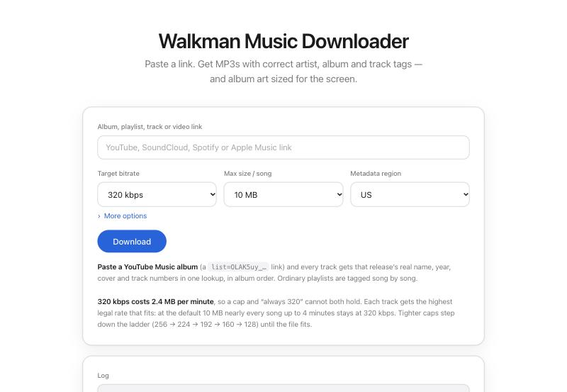

# Walkman Music Downloader

**Get MP3s with the correct artist, album and track tags — and album art sized
for the screen.** Built for the Sony Walkman E-series, useful for any hardware
MP3 player that sorts your library by ID3 tags.

[](LICENSE)


<p align="center">
  
</p>

---

## The problem this solves

Most YouTube-to-MP3 tools hand you the video title and nothing else. A hardware
player sorts by **tags**, not filenames — so everything lands under *Unknown
Artist* with a letterboxed video thumbnail for a cover.

| | Typical downloader | This one |
|---|---|---|
| **Filename** | `Artist - Song (Official Music Video) [4K] ｜ Label.mp3` | `Artist/Album/04 - Song.mp3` |
| **Artist** | — | `Artist Name` |
| **Album** | — | `Album Name` |
| **Track no.** | — | `4/12` |
| **Year / genre** | — | `2024` · `Alternative` |
| **Cover art** | video thumbnail, or none | 500×500 baseline JPEG |

---

## Why it works on a Walkman when other tools don't

Every one of these exists because a Walkman E-series refused to display
something:

- **ID3v2.3 tags, not v2.4** — plus an ID3v1 tail. These players only partly
  understand v2.4.
- **Baseline JPEG cover art.** Progressive JPEGs render blank on Walkman
  firmware. Art is always re-encoded baseline, square, 500 px.
- **Latin-1 text with a UTF-16 fallback.** UTF-8 ID3 frames show as garbage.
- **Only legal MPEG-1 Layer III bitrates.** Ask libmp3lame for 288 kbps and it
  silently gives you 256 — so the ladder is 320/256/224/192/160/128.
- **FAT32-safe filenames**, shallow `Artist/Album/` folders, 44.1 kHz stereo CBR.

## Clean titles, automatically

`Official Music Video`, `4K`, `2023 Remaster`, `Lyrical`, genre tags, label
names and `#hashtags` are stripped — while real parenthetical titles like
*Breathe (In the Air)* survive.

## Size caps that respect your storage

320 kbps costs **2.4 MB per minute**, so "always 320" and an 8 MB cap cannot
both hold past ~3:20. Set a per-file cap and each track gets the highest legal
bitrate that fits:

| Song length | 7 MB cap | 10 MB cap (default) |
|---|---|---|
| 3:00 | 256 | **320** |
| 4:00 | 224 | **320** |
| 4:30 | 192 | 256 |
| 6:00 | 128 | 224 |

---

## Supported links

**Audio downloaded directly** — these sites serve audio openly:

`YouTube` · `YouTube Music` · `SoundCloud` · `Bandcamp` · `Mixcloud` ·
`Audiomack` — plus everything else [yt-dlp](https://github.com/yt-dlp/yt-dlp)
supports.

**Tracklist only** — `Spotify` · `Apple Music`

Their audio is DRM-protected and **this tool never touches it**. Only the public
tracklist is read — song names, artists, durations — and each song is then
located on one of the open sites above. You get correct tags; their streams stay
untouched. No account, no API key, no DRM circumvention.

Tidal, Deezer and Amazon Music publish no keyless public tracklist, so they are
reported as unsupported rather than guessed at.

---

## Install

Needs **Python 3.10+** and **ffmpeg**.

```bash
git clone https://github.com/reddotconsultancy/walkman-music-downloader.git
cd walkman-music-downloader
./setup.sh
```

ffmpeg: `brew install ffmpeg` (macOS) · `sudo apt install ffmpeg` (Debian/Ubuntu)

## Use it

```bash
./run.sh
```

Opens at `http://127.0.0.1:7788`. Paste a link, press Download.

Same engine from the command line:

```bash
.venv/bin/python cli.py "https://music.youtube.com/playlist?list=OLAK5uy_..." --max-mb 10
```

| Flag | What it does |
|---|---|
| `--max-mb 8` | Per-file size cap (default 10) |
| `--bitrate 320` | Target bitrate before the cap applies |
| `--country IN` | Metadata region — use `IN` for Bollywood/Punjabi releases |
| `--items 4,5` | Only these album positions, keeping real track numbers |
| `--album-mode always` | Treat any playlist as one release |
| `--flat` | No `Artist/Album` subfolders |
| `--cookies-from-browser chrome` | For age-restricted or region-locked items |
| `--report out.csv` | Write a CSV of everything fetched |

---

## Where the metadata comes from

Three free, keyless sources, in order:

1. **[iTunes Search API](https://performance-partners.apple.com/search-api)** — primary catalogue.
2. **[MusicBrainz](https://musicbrainz.org/)** — fallback. Covers releases iTunes is
   missing entirely (*The Dark Side of the Moon* is absent from iTunes' album
   search in every storefront tested).
3. **[Cover Art Archive](https://coverartarchive.org/)** — art for MusicBrainz releases.

**Album mode** resolves the whole release in one lookup instead of searching each
song separately — that is what keeps an album in one folder with correct track
numbers, rather than scattering it across a cover band's single, a live EP and a
greatest-hits compilation.

Set the metadata region to match the music: `IN` finds Malayalam, Hindi and
Punjabi releases the US storefront does not carry.

---

## Copying to the Walkman

```bash
cp -R ~/Desktop/Walkman\ Music/* /Volumes/WALKMAN/MUSIC/
```

Eject properly — the player rebuilds its database on disconnect, and that is
when tags and cover art get picked up.

---

## FAQ

**Does this work on Walkman NW-E393 / E394 / E395?**
Yes — the E-series is what it was built and tested against. It also suits any
FAT32 player that reads ID3 tags: older iPods, Sansa Clip, generic DAPs.

**Why are my files not 320 kbps?**
Because they wouldn't fit your size cap. 320 kbps is 2.4 MB per minute. Raise
the cap or accept the step-down — 256 kbps is transparent on earbuds.

**Why is the album art blank on my player?**
If art came from elsewhere, it is probably a progressive JPEG. Re-download with
this tool; it always re-encodes baseline.

**Can I host this as a website for other people?**
Not practically. It needs ffmpeg, long-running jobs and a writable disk, so
GitHub Pages and most serverless hosts are out — and YouTube blocks datacenter
IP ranges, so a cloud-hosted copy gets bot-checked almost immediately. It is
designed to run on your own machine.

**Does it need a Spotify or Apple Music API key?**
No. Nothing here needs an account or a key.

---

## Legal

A personal tool for getting music onto a hardware player that only reads local
files. It downloads nothing on its own — you give it a link, it fetches that
link with yt-dlp, transcodes with ffmpeg and writes tags with mutagen. It does
not break DRM and does not access protected streams.

Check what your local law allows and what each site's terms permit before using
it, and don't redistribute what you download.

## License

MIT — see [LICENSE](LICENSE).
